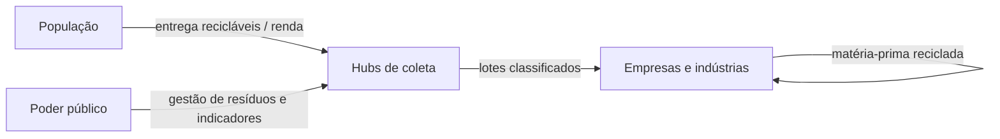

# ♻️ Lucre com a Sustentabilidade

> Plataforma de economia circular que conecta quem gera materiais recicláveis a recicladores, cooperativas e indústrias no **Ceará** (referência inicial: **Fortaleza–CE**).

  

Site no ar: **https://devoltaaouso.lovable.app** (interface ainda com a marca provisória "Circular").

## Sumário
1. [Apresentação](#apresentação) · 2. [Visão de negócio](#visão-de-negócio) · 3. [Funcionalidades](#funcionalidades) · 4. [Arquitetura](#arquitetura) · 5. [Banco de dados](#banco-de-dados) · 6. [Indicadores de impacto](#indicadores-de-impacto) · 7. [Relevância profissional](#relevância-profissional) · 8. [Instalação](#instalação-e-execução) · 9. [Roadmap](#roadmap) · 10. [Contribuição](#licença-e-contribuição)

## Apresentação
**Problema:** grande parte dos recicláveis termina em aterros porque quem gera não sabe como destiná-los corretamente, e quem compra não tem acesso a material confiável e rastreável.

**Proposta de valor:** um ponto único para anunciar lotes, consultar preços de referência **com fonte e data**, e enviar propostas — com regras explícitas.

**Diferenciais:** preços rastreáveis (fonte, URL, data, tipo, verificação) · foco inicial: regional no Ceará · catálogo restrito a materiais autorizados · assistente de dúvidas que responde só com conteúdo aprovado.

## Visão de negócio

- **População:** gera renda entregando materiais recicláveis.
- **Empresas e indústrias:** acessam matéria-prima reciclada.
- **Poder público:** fortalece a gestão de resíduos e os resultados ambientais.

### Materiais autorizados
Alumínio · Latinhas de alumínio · Ferro · Aço · Papelão · Papel · Garrafa PET · Vidro (embalagens inteiras) · Resíduos eletroeletrônicos (inclui baterias e pilhas).


## Funcionalidades
### ✅ Implementadas
| Funcionalidade | Situação |
|---|---|
| Catálogo de lotes com busca, filtro por material e cidade do CE | Lotes **demonstrativos**, valores "a combinar" |
| Página do lote e envio de proposta | Proposta real, registrada na planilha da equipe |
| Anúncio de material | Registrado na planilha da equipe |
| Preços de referência de Fortaleza | Com fonte, data e nível de confirmação |
| Assistente de dúvidas com IA | Responde só com conteúdo aprovado; sem resposta → equipe |
| Cadastro e login (e-mail/senha, Google) | Perfis de acesso por papel |

### 🚧 Ainda não implementadas
Recebimento e pesagem, formação de lotes reais, estoque, compactação, vendas, logística e indicadores — modeladas, não construídas.

## Arquitetura
| Camada | Tecnologia |
|---|---|
| Frontend | React 19, TanStack Start/Router, Tailwind CSS v4 |
| Backend | Funções de servidor TanStack (edge runtime) |
| Banco de dados | PostgreSQL gerenciado (Lovable Cloud) com RLS |
| Autenticação | Lovable Cloud Auth (e-mail/senha, Google) |
| IA | Lovable AI Gateway |
| Integrações | Google Sheets (caixa de entrada da equipe) |
| Versionamento | Git, sincronizável com GitHub |

## Banco de dados
Tabelas atuais: `hubs`, `profiles`, `user_roles`, `materials`, `material_prices`. Detalhes, relacionamentos e regras em [docs/banco-de-dados.md](docs/banco-de-dados.md).

**Preços:** cada linha guarda material, R$/kg, moeda (BRL), cidade, UF (CE), fonte, URL, item da fonte, data de consulta, data de referência, tipo (`anunciado` / `media_referencia` / `cotacao_confirmada`) e situação. Novas cotações criam novas linhas (histórico preservado). Fontes: [docs/fontes-e-precos.md](docs/fontes-e-precos.md).

## Indicadores de impacto
Planejados (sem dados reais ainda — nenhum número é divulgado): kg recuperados · renda gerada para participantes · volume comercializado · materiais destinados à reciclagem · potencial de redução de envio a aterros.

## Relevância profissional
Gestão ambiental · economia circular · ESG · logística reversa (inclui eletroeletrônicos e baterias) · rastreabilidade de resíduos · inovação social · gestão inteligente de recursos.

## Instalação e execução
```sh
git clone <url-do-repositorio>
cd <pasta>
bun install        # ou npm install
cp .env.example .env   # preencha com URL e chave pública do seu backend
bun run dev        # http://localhost:8080
bun run test       # testes automatizados
```
Nunca coloque chaves secretas em variáveis `VITE_` nem no repositório. As migrações ficam em `drizzle/migrations/`.

## Roadmap
- **Feito:** catálogo, preços rastreáveis de Fortaleza, propostas e anúncios, assistente, login e perfis.
- **Em desenvolvimento:** painel administrativo de materiais e preços.
- **Futuro:** recebimento e pesagem nos hubs, lotes e estoque reais, vendas, logística, painel de impacto ESG.

## Licença e contribuição
Licença ainda não definida. Para contribuir: abra uma issue, crie uma branch, mantenha os testes passando e **nunca** adicione preços sem fonte verificável.
