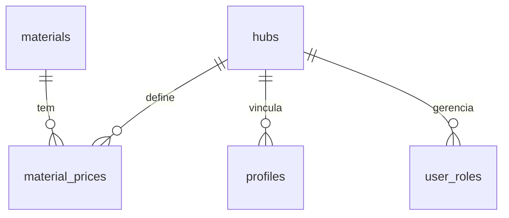

# Banco de dados

| Tabela | Finalidade |
|---|---|
| `hubs` | Pontos de coleta (hoje: Hub Piloto, Fortaleza–CE, demonstração) |
| `profiles` | Dados do usuário (1:1 com a conta) |
| `user_roles` | Perfis de acesso: admin, gestor_hub, operador, participante, empresa |
| `materials` | Materiais autorizados (`active = false` para os retirados) |
| `material_prices` | Histórico de preços por material e hub, com fonte e verificação |

## Regras de integridade
- Pesos `numeric(12,3)`, dinheiro `numeric(12,2)`; moeda sempre `BRL`, estado sempre `CE`.
- `price_type`: `anunciado`, `media_referencia`, `cotacao_confirmada`.
- `verification_status`: `verificado`, `nao_verificado`, `expirado`.
- Preço vigente = `valid_to IS NULL`. Novas cotações criam linhas novas.
- Segurança por linha: leitura pública de materiais e preços; escrita só por admin ou gestor do hub. Papéis checados por `has_role` / `manages_hub`.

Migrações: `drizzle/migrations/`.
